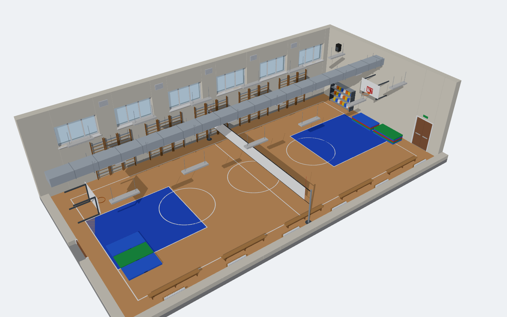
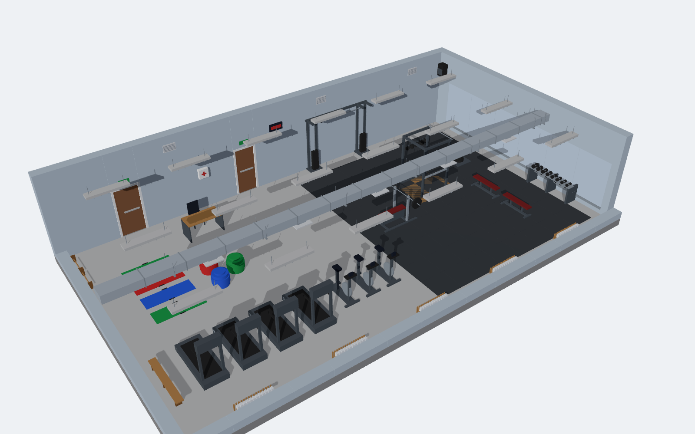
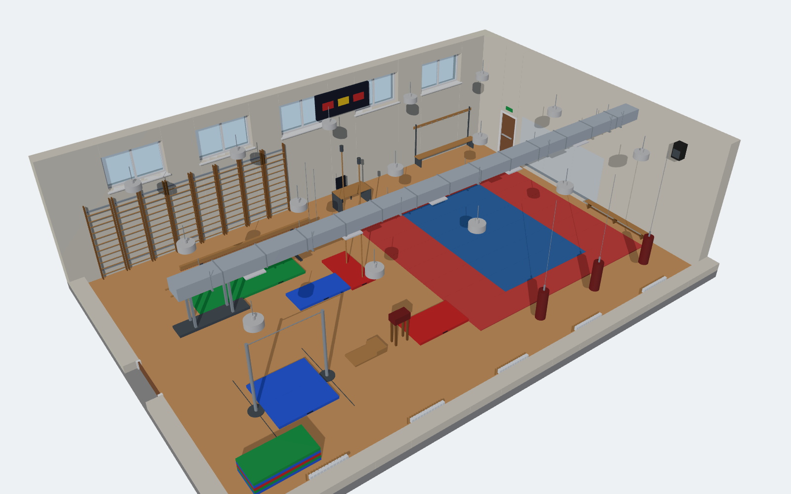

# Карточка №15 — проект спортивного зала в КОМПАС-3D (3 варианта)

**Задание.** Создать в КОМПАС-3D проект спортивного зала: сам зал (планировка, окна,
двери) и оборудование в нём (тренажёры, гимнастические стенки, маты, скамьи).
Дополнительно можно добавить вентиляцию и освещение.

Во всех трёх вариантах есть ограждающие конструкции, окна, двери, оборудование,
освещение, вентиляция и отопление.

| | Вариант 1 | Вариант 2 | Вариант 3 |
|---|---|---|---|
| Назначение | Школьный универсальный зал | Тренажёрный (фитнес) зал | Гимнастика и единоборства |
| Размеры (Д×Ш×В) | 24 × 12 × 6 м | 18 × 10 × 3,6 м | 18 × 12 × 5 м |
| Пол | спортивный паркет с разметкой | наливной пол + резиновая плитка | паркет + татами 8×8 м |
| Окна / двери | 12 окон, 2 двустворчатые двери | 5 окон, 2 двери | 10 окон, 2 двери |
| Оборудование | баскетбольные щиты, волейбольная сетка, 15 секций шведской стенки, скамьи, маты, стеллаж с мячами, табло | беговые дорожки, велотренажёры, силовая рама, жим лёжа, гантели, блины, гири, кроссовер, зеркала, коврики, фитболы | перекладина, брусья, бревно, козёл с мостиком, кольца, канаты, шведские стенки, маты, боксёрские мешки |
| Свет | линейные светильники в защитной решётке | линейные светильники | купольные светильники |
| Вентиляция | приточный воздуховод 800×500 + вытяжные решётки | воздуховод 500×300 + вытяжка | воздуховод 600×400 + вытяжка |
| Подробно | [out/variant1_school](out/variant1_school/README.md) | [out/variant2_fitness](out/variant2_fitness/README.md) | [out/variant3_gymnastics](out/variant3_gymnastics/README.md) |

| Вариант 1 | Вариант 2 | Вариант 3 |
|---|---|---|
|  |  |  |

В папке каждого варианта лежат:
- STEP-модель для КОМПАС-3D;
- `viewer.html` — 3D-просмотр в браузере: модель можно вращать, а при наведении на объект видно его название;
- картинки: 3D-вид и план;
- `README.md` со спецификацией всего оборудования и его габаритами.

---

## Как получить модель в КОМПАС-3D

### Способ 1. Открыть готовую STEP-модель (самый быстрый)

1. КОМПАС-3D → **Файл → Открыть** → тип файлов **STEP (\*.stp; \*.step)**.
2. Выбрать, например, `out/variant1_school/variant1_school.step`.
3. Модель откроется **сборкой**. Каждая стена, окно, скамья, тренажёр и светильник —
   отдельный именованный компонент со своим цветом.
4. **Файл → Сохранить как** → `Спортзал.a3d`.

> Ось Z модели направлена вверх. Если зал отображается «лёжа», выберите ориентацию
> «Сверху» или «Изометрия XYZ». Чтобы заглянуть внутрь, скройте компонент «Перекрытие».

### Способ 2. Построить модель операциями КОМПАС (макрос)

Скрипт `kompas_build.py` строит зал прямо в КОМПАС-3D обычными операциями
(эскиз → выдавливание, эскиз → вращение). В итоге получается деталь `.m3d` с полным деревом построения.

```bat
pip install pywin32
python kompas_build.py 1      :: 1, 2 или 3 — номер варианта
```

Ещё скрипт можно открыть в КОМПАС-3D через **Приложения → Python** и задать номер
варианта в переменной `VARIANT` в начале файла. На построение уходит несколько минут
(118–196 операций), результат сохраняется в `out/<вариант>/<вариант>.m3d`.

### Способ 3. Построить вручную (для защиты работы)

Все размеры есть в спецификации и на плане (`plan.png`). Порядок работы:

1. **Зал** (деталь `Зал.m3d`).
   - На плоскости XY нарисуйте эскиз: прямоугольник по наружному контуру стен
     и внутри него второй прямоугольник по внутренним размерам зала.
     Выдавите на высоту зала (например, 6000 мм). Получатся стены.
   - Оконные и дверные проёмы: эскиз на внутренней грани стены → прямоугольники проёмов →
     **Вырезать выдавливанием** «Через всё». Размеры и шаг проёмов указаны в README варианта.
   - Пол: эскиз на нижней грани → прямоугольник → выдавить вниз на 300 мм.
2. **Окно** и **дверь** — отдельные детали: рама (прямоугольник с отверстием, выдавить на 80 мм),
   стекло (выдавить на 24 мм, полупрозрачный цвет), полотно двери на 45 мм.
3. **Оборудование** — каждое изделие отдельной деталью:
   - *Скамья* 3000×240×300: сиденье (выдавливание 40 мм) и три ножки;
   - *Мат* 2000×1000×100: одно выдавливание;
   - *Шведская стенка* 900×3000: две стойки 40×150 и перекладины (цилиндр Ø34)
     с шагом 250 мм. Перекладины удобно размножить командой **Массив по сетке**;
   - тренажёры собираются из параллелепипедов и цилиндров по габаритам из спецификации.
4. **Сборка** `Спортзал.a3d`: вставьте зал (зафиксировать), затем окна, двери и оборудование.
   Положение задаётся сопряжениями «Совпадение» (с полом, со стеной) и «На расстоянии».
   Одинаковые предметы удобно размножить **массивом**.
5. **Освещение и вентиляция**: светильник (корпус + рассеиватель + тросы) и воздуховод
   (прямоугольный профиль, выдавленный на длину зала, + диффузоры). Вставьте в сборку
   под потолком и размножьте массивом по сетке.
6. Назначьте цвета (**Свойства → Цвет**). Для отчёта сделайте фото-реалистичный рендер
   (Artisan Rendering) или сохраните виды в картинки.

---

## Устройство репозитория

```
gym/                     параметрическое описание залов (чистый Python, без зависимостей)
  scene.py               примитивы: параллелепипед, вертикальный и горизонтальный цилиндр
  room.py                стены с проёмами, окна, двери, пол, перекрытие, свет, вентиляция, радиаторы
  equipment.py           оборудование (скамья, мат, шведская стенка, тренажёры, снаряды...)
  variants/v1_school.py  вариант 1
  variants/v2_fitness.py вариант 2
  variants/v3_gymnastics.py вариант 3
kompas_build.py          макрос для КОМПАС-3D (API 5, pywin32)
tools/export_step.py     экспорт в STEP (CadQuery)
tools/export_viewer.py   HTML-просмотрщик (three.js)
tools/render_plan.py     план зала (matplotlib)
tools/make_docs.py       спецификации README.md
tools/screenshot.mjs     снимок 3D-вида из viewer.html (Playwright)
out/                     готовые результаты для трёх вариантов
```

Чтобы изменить зал (например, размеры, количество окон или расстановку тренажёров),
отредактируйте файл варианта в `gym/variants/` и пересоберите результаты:

```bash
pip install cadquery matplotlib
python tools/export_step.py
python tools/render_plan.py
python tools/make_docs.py
python tools/export_viewer.py path/to/three.min.js    # three@0.160.0
node tools/screenshot.mjs "$PWD/out/variant1_school/viewer.html" out/variant1_school/preview_3d.png
```
