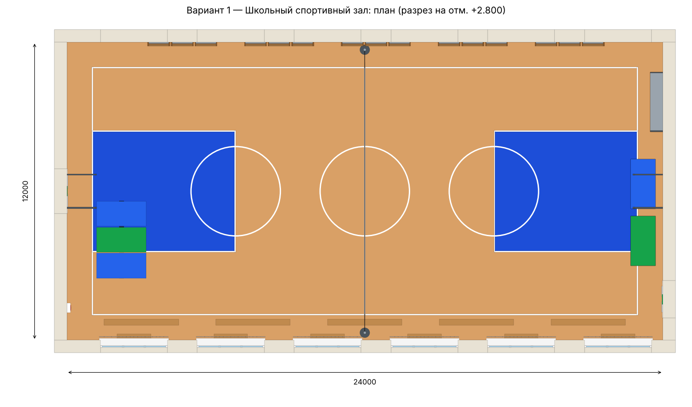

# Вариант 1 — Школьный спортивный зал

Баскетбольная/волейбольная площадка, гимнастические стенки по северной
стене, скамьи, маты, стеллаж с мячами, табло. Ленточные окна по обеим
длинным стенам, двустворчатые двери в торцах. Освещение — линейные
светильники в защитной решётке, приточная вентиляция по оси зала,
вытяжные решётки, радиаторы с деревянными экранами.

**Внутренние размеры:** 24 × 12 м, высота 6 м, площадь 288 м².

## Файлы

| Файл | Что это |
|---|---|
| `variant1_school.step` | Модель для КОМПАС-3D: «Файл → Открыть» → тип STEP. Откроется сборкой, где каждый объект — отдельный компонент |
| `viewer.html` | Интерактивный 3D-просмотр в браузере (вращение мышью, подписи объектов) |
| `preview_3d.png`, `plan.png` | Картинки для отчёта/презентации |

Построить модель «родными» операциями КОМПАС: `python kompas_build.py 1` (см. корневой README).

## Строительные конструкции

| № | Наименование | Кол-во | Габариты Д×Ш×В, мм |
|---|---|---|---|
| 1 | Плита пола | 1 | 25020×13020×300 |
| 2 | Паркет спортивный | 1 | 24000×12000×10 |
| 3 | Стена южная | 1 | 25020×510×6000 |
| 4 | Окно | 12 | 2800×375×2040 |
| 5 | Защитная решётка окна | 6 | 2780×30×2000 |
| 6 | Стена северная | 1 | 25020×510×6000 |
| 7 | Стена западная | 1 | 510×12000×6000 |
| 8 | Дверь | 2 | 160×1800×2400 |
| 9 | Указатель «Выход» | 2 | 30×400×150 |
| 10 | Стена восточная | 1 | 510×12000×6000 |
| 11 | Перекрытие | 1 | 25020×13020×250 |

## Спортивное оборудование и оснащение

| № | Наименование | Кол-во | Габариты Д×Ш×В, мм |
|---|---|---|---|
| 1 | Разметка площадки | 1 | 22000×10000×2 |
| 2 | Волейбольная стойка | 2 | 400×400×2550 |
| 3 | Волейбольная сетка | 1 | 16×11300×1000 |
| 4 | Антенны сетки | 1 | 10×10410×1800 |
| 5 | Баскетбольный щит | 2 | 1236×1800×1260 |
| 6 | Баскетбольное кольцо | 2 | 618×484×40 |
| 7 | Гимнастическая стенка | 15 | 900×157×3000 |
| 8 | Скамья гимнастическая | 5 | 3000×240×300 |
| 9 | Стопка матов | 2 | 1000×2000×498 |
| 10 | Мат гимнастический | 3 | 2000×1030×100 |
| 11 | Стеллаж для инвентаря | 1 | 500×2400×1800 |
| 12 | Мячи | 1 | 230×2050×1430 |
| 13 | Табло электронное | 1 | 2400×130×1000 |
| 14 | Часы настенные | 1 | 65×600×300 |
| 15 | Аптечка | 1 | 155×400×400 |
| 16 | Акустическая колонка | 2 | 305×350×550 |

## Освещение, вентиляция, отопление

| № | Наименование | Кол-во | Габариты Д×Ш×В, мм |
|---|---|---|---|
| 1 | Светильник | 12 | 1500×320×930 |
| 2 | Воздуховод приточный | 1 | 24110×840×540 |
| 3 | Диффузор | 6 | 600×600×160 |
| 4 | Подвесы воздуховода | 1 | 21650×920×740 |
| 5 | Вытяжная решётка | 5 | 600×45×400 |
| 6 | Радиатор отопления | 6 | 1200×100×550 |
| 7 | Экран радиатора | 6 | 1360×190×780 |
