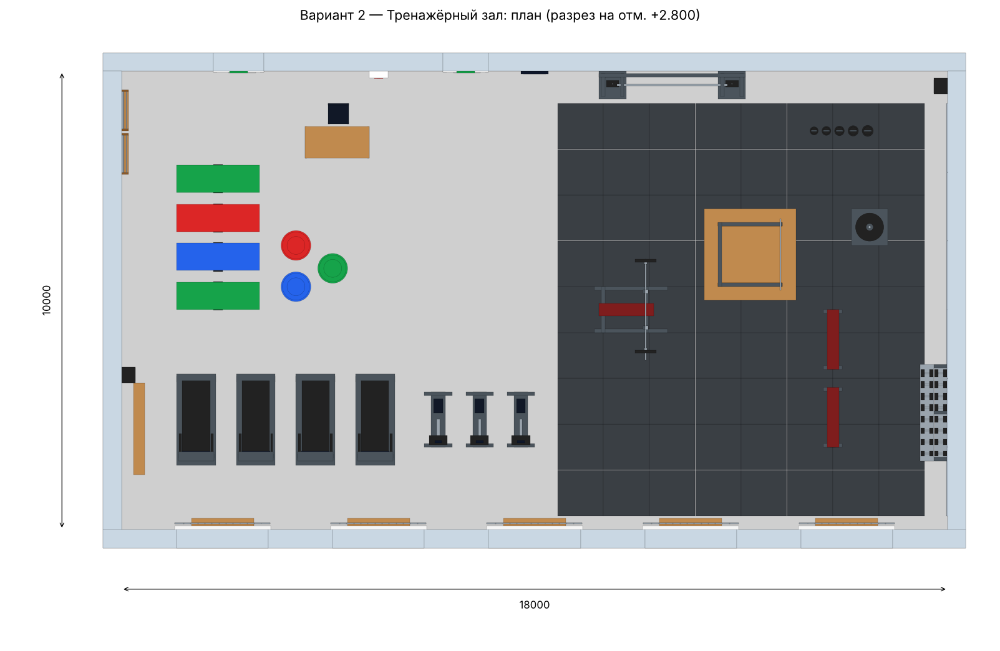

# Вариант 2 — Тренажёрный зал

Зонирование: кардиозона у окон (беговые дорожки, велотренажёры),
зона свободных весов (силовая рама, жим лёжа, гантели, блины, гири,
кроссовер) на резиновом покрытии, зона растяжки (коврики, фитболы,
шведская стенка). Зеркала по восточной стене, стойка тренера у входа.
Окна — по южной стене, две двери (вход и в раздевалку) — по северной.

**Внутренние размеры:** 18 × 10 м, высота 3.6 м, площадь 180 м².

## Файлы

| Файл | Что это |
|---|---|
| `variant2_fitness.step` | Модель для КОМПАС-3D: «Файл → Открыть» → тип STEP. Откроется сборкой, где каждый объект — отдельный компонент |
| `viewer.html` | Интерактивный 3D-просмотр в браузере (вращение мышью, подписи объектов) |
| `preview_3d.png`, `plan.png` | Картинки для отчёта/презентации |

Построить модель «родными» операциями КОМПАС: `python kompas_build.py 2` (см. корневой README).

## Строительные конструкции

| № | Наименование | Кол-во | Габариты Д×Ш×В, мм |
|---|---|---|---|
| 1 | Плита пола | 1 | 18800×10800×300 |
| 2 | Наливной пол | 1 | 18000×10000×10 |
| 3 | Стена южная | 1 | 18800×400×3600 |
| 4 | Окно | 5 | 2100×320×1840 |
| 5 | Защитная решётка окна | 5 | 2080×30×1800 |
| 6 | Стена северная | 1 | 18800×400×3600 |
| 7 | Дверь | 2 | 1100×160×2100 |
| 8 | Указатель «Выход» | 2 | 400×30×150 |
| 9 | Стена западная | 1 | 400×10000×3600 |
| 10 | Стена восточная | 1 | 400×10000×3600 |
| 11 | Перекрытие | 1 | 18800×10800×250 |

## Спортивное оборудование и оснащение

| № | Наименование | Кол-во | Габариты Д×Ш×В, мм |
|---|---|---|---|
| 1 | Беговая дорожка | 4 | 850×2000×1720 |
| 2 | Велотренажёр | 3 | 600×1200×1320 |
| 3 | Резиновое покрытие | 1 | 7996×8996×20 |
| 4 | Зеркала | 1 | 30×9000×2100 |
| 5 | Стойка для гантелей | 1 | 600×2100×780 |
| 6 | Гантель | 16 | 260×110×110 |
| 7 | Скамья регулируемая | 2 | 400×1300×460 |
| 8 | Силовая рама | 1 | 1400×1560×2356 |
| 9 | Платформа | 1 | 2000×2000×20 |
| 10 | Скамья для жима | 1 | 1600×1000×1210 |
| 11 | Штанга олимпийская | 1 | 450×2200×450 |
| 12 | Стойка для блинов | 1 | 800×800×740 |
| 13 | Блин | 7 | 450×450×50 |
| 14 | Кроссовер | 1 | 3200×600×2440 |
| 15 | Гиря | 5 | 180×180×252 |
| 16 | Гимнастическая стенка | 2 | 157×900×2700 |
| 17 | Коврик для фитнеса | 4 | 1800×630×34 |
| 18 | Фитбол | 3 | 650×650×650 |
| 19 | Скамья гимнастическая | 1 | 240×2000×300 |
| 20 | Стол тренера | 1 | 1400×700×750 |
| 21 | Стул | 1 | 450×450×940 |
| 22 | Аптечка | 1 | 400×155×400 |
| 23 | Часы настенные | 1 | 600×65×300 |
| 24 | Акустическая колонка | 2 | 305×350×550 |

## Освещение, вентиляция, отопление

| № | Наименование | Кол-во | Габариты Д×Ш×В, мм |
|---|---|---|---|
| 1 | Светильник | 18 | 1500×320×430 |
| 2 | Воздуховод приточный | 1 | 18000×540×340 |
| 3 | Диффузор | 5 | 600×600×160 |
| 4 | Подвесы воздуховода | 1 | 15650×620×490 |
| 5 | Вытяжная решётка | 3 | 500×45×300 |
| 6 | Радиатор отопления | 5 | 1200×100×550 |
| 7 | Экран радиатора | 5 | 1360×190×780 |
