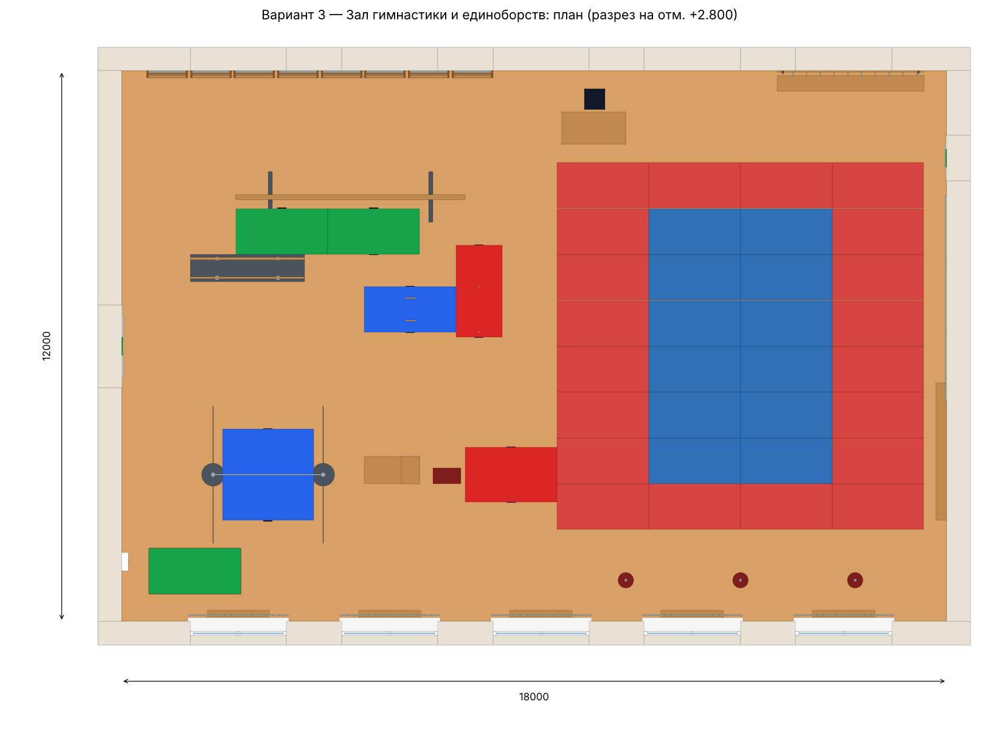

# Вариант 3 — Зал гимнастики и единоборств

Западная половина — гимнастическая зона (перекладина, брусья, бревно,
козёл с мостиком, кольца, канаты, гимнастические стенки, маты);
восточная — зона единоборств на татами 8 x 8 м с боксёрскими мешками.
Окна по южной стене (с защитными решётками) и верхний ряд по северной,
двери в торцах. Купольные светильники, приточный воздуховод.

**Внутренние размеры:** 18 × 12 м, высота 5 м, площадь 216 м².

## Файлы

| Файл | Что это |
|---|---|
| `variant3_gymnastics.step` | Модель для КОМПАС-3D: «Файл → Открыть» → тип STEP. Откроется сборкой, где каждый объект — отдельный компонент |
| `viewer.html` | Интерактивный 3D-просмотр в браузере (вращение мышью, подписи объектов) |
| `preview_3d.png`, `plan.png` | Картинки для отчёта/презентации |

Построить модель «родными» операциями КОМПАС: `python kompas_build.py 3` (см. корневой README).

## Строительные конструкции

| № | Наименование | Кол-во | Габариты Д×Ш×В, мм |
|---|---|---|---|
| 1 | Плита пола | 1 | 19020×13020×300 |
| 2 | Паркет спортивный | 1 | 18000×12000×10 |
| 3 | Стена южная | 1 | 19020×510×5000 |
| 4 | Окно | 10 | 2200×375×2240 |
| 5 | Защитная решётка окна | 5 | 2180×30×2200 |
| 6 | Стена северная | 1 | 19020×510×5000 |
| 7 | Стена западная | 1 | 510×12000×5000 |
| 8 | Дверь | 2 | 160×1800×2400 |
| 9 | Указатель «Выход» | 2 | 30×400×150 |
| 10 | Стена восточная | 1 | 510×12000×5000 |
| 11 | Перекрытие | 1 | 19020×13020×250 |

## Спортивное оборудование и оснащение

| № | Наименование | Кол-во | Габариты Д×Ш×В, мм |
|---|---|---|---|
| 1 | Гимнастическая стенка | 8 | 900×157×3000 |
| 2 | Перекладина гимнастическая | 1 | 2900×500×2600 |
| 3 | Растяжки перекладины | 1 | 2420×3000×15 |
| 4 | Мат гимнастический | 7 | 2000×1030×100 |
| 5 | Брусья параллельные | 1 | 2500×600×1675 |
| 6 | Бревно гимнастическое | 1 | 5000×1100×1310 |
| 7 | Козёл гимнастический | 1 | 600×350×1150 |
| 8 | Мостик гимнастический | 1 | 1200×600×200 |
| 9 | Гимнастические кольца | 1 | 240×528×2650 |
| 10 | Канат для лазания | 2 | 120×120×4700 |
| 11 | Стопка матов | 1 | 2000×1000×498 |
| 12 | Татами | 1 | 7996×7996×40 |
| 13 | Боксёрский мешок | 3 | 340×340×4400 |
| 14 | Скамья с вешалкой | 1 | 3200×450×1900 |
| 15 | Скамья гимнастическая | 1 | 240×3000×300 |
| 16 | Зеркала | 1 | 30×4500×2100 |
| 17 | Стол тренера | 1 | 1400×700×750 |
| 18 | Стул | 1 | 450×450×940 |
| 19 | Табло электронное | 1 | 2400×130×1000 |
| 20 | Часы настенные | 1 | 65×600×300 |
| 21 | Аптечка | 1 | 155×400×400 |
| 22 | Акустическая колонка | 2 | 305×350×550 |

## Освещение, вентиляция, отопление

| № | Наименование | Кол-во | Габариты Д×Ш×В, мм |
|---|---|---|---|
| 1 | Светильник | 15 | 520×520×810 |
| 2 | Воздуховод приточный | 1 | 18110×640×440 |
| 3 | Диффузор | 5 | 600×600×160 |
| 4 | Подвесы воздуховода | 1 | 15650×720×640 |
| 5 | Вытяжная решётка | 2 | 45×600×400 |
| 6 | Радиатор отопления | 5 | 1200×100×500 |
| 7 | Экран радиатора | 5 | 1360×190×730 |
